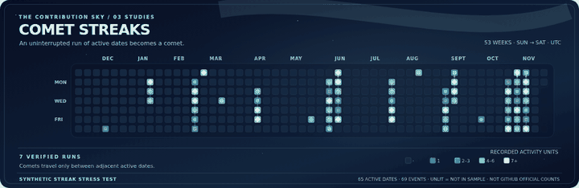
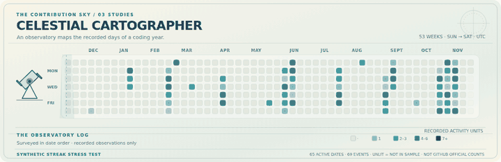
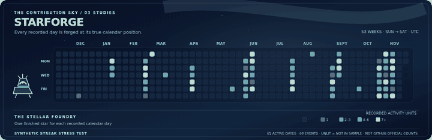

# GitHub Constellation

**A year of coding activity, written in stars.** Three distinct animated reinterpretations of the familiar GitHub contribution calendar, with a 53-week by seven-day lattice and source-backed star positions.

**Status:** Working animation engine and visual prototypes migrated from [GitHub-Activity-Studio](https://github.com/AdityaSreevatsaK/GitHub-Activity-Studio/pull/1) at source commit [be7f524](https://github.com/AdityaSreevatsaK/GitHub-Activity-Studio/commit/be7f524597285c2078565068ab23a683316404a2). The current previews use **explicitly synthetic events**, NOT real activity for AdityaSreevatsaK. An official GitHub contribution-calendar collector and profile automation remain next-stage work.

## Three animation designs

| Concept | Night | Paper |
|:--|:--|:--|
| **Comet Streaks**: a comet follows consecutive active calendar dates, with breaks wherever activity is absent |  |  |
| **Celestial Cartographer**: a miniature observatory reveals activity chronologically |  |  |
| **Starforge**: sparks travel from a forge to exact recorded dates, leaving permanent day-stars |  |  |

Each design has six source-controlled SVG representations across the two sample datasets, two themes and animated/still variants. The six native 16-second GIFs have been regenerated and committed by [the preview-generation workflow](.github/workflows/generate-gifs.yml) using Pillow and headless Chromium. The committed SVG stills above remain reliable reduced-motion alternatives. Actual playback through GitHub's image proxy still needs independent visual confirmation.

## Animated showcase

The following animations show the explicitly labelled **SYNTHETIC STREAK STRESS TEST** fixture, not the owner's contribution history. Each GIF plays for 16 seconds and has a motionless SVG alternative.

### Comet Streaks

[Paper GIF](assets/stress/comet-paper.gif) · [Night still](assets/stress/comet-night-still.svg) · [Paper still](assets/stress/comet-paper-still.svg)

### Celestial Cartographer

[Night GIF](assets/stress/cartographer-night.gif) · [Night still](assets/stress/cartographer-night-still.svg) · [Paper still](assets/stress/cartographer-paper-still.svg)

### Starforge

[Paper GIF](assets/stress/starforge-paper.gif) · [Night still](assets/stress/starforge-night-still.svg) · [Paper still](assets/stress/starforge-paper-still.svg)

All six GIFs are included in this repository: three distinct animation concepts, two themes each. Brightness means **mixed recorded activity units in the demo**, not official GitHub contribution counts. Empty cells mean that the sample contains no event, not that GitHub has certified zero contributions.

## Try it locally on Windows

Requires Node.js 20+ and Python 3.11+; the SVG renderer has **no npm dependencies**.

~~~powershell
git clone https://github.com/AdityaSreevatsaK/GitHub-Constellation.git
cd GitHub-Constellation

# Verify deterministic calendar model, SVG motion and data validation
node --test tests/test_engine.mjs tests/test_motion.mjs

# Regenerate all still and animated SVGs from the ten-event synthetic fixture
node export.mjs

# Regenerate the richer 65-active-day demonstration
node export.mjs --input fixtures/streak-demo.json --out assets/stress --label "SYNTHETIC STREAK STRESS TEST"

# Serve a local interactive gallery
py -3 -m http.server 8000
~~~

Open **http://localhost:8000/preview.html**. The gallery supports all three designs, both themes, two fixtures, side-by-side comparison, pause and keyboard-readable day inspection. On mobile, calendars scroll horizontally within their panels.

Optional animated GIF generation:

~~~powershell
py -3 -m pip install pillow playwright
py -3 -m playwright install chromium
py -3 export_gif.py
py -3 -m unittest tests/test_gif.py -v
py -3 tests/browser_smoke.py
~~~

GIFs are 720 by 234 pixels, play for 16 seconds and must pass frame-duration and visible-motion tests.

## Architecture at a glance

- **engine.mjs**: strict event snapshot parser, date-to-cell mapping, daily aggregation, streaks, three SVG renderers and themes.
- **export.mjs**: offline, deterministic SVG export.
- **export_gif.py**: optional Chromium/Pillow GIF capture, timing preservation and playback validation.
- **preview.html**: interactive browser gallery with source-based inspector and accessibility controls.
- **fixtures/**: ten-event and stress-test **synthetic** snapshots.
- **tests/**: JavaScript, Python, GIF and browser smoke regression suites.
- **assets/**: generated still and animated SVGs; stress assets include workflow-generated GIF previews.
- **docs/**: architecture, data contracts, migration provenance, developer instructions, test plan and agent roadmap.

Start with [AGENTS.md](AGENTS.md) when using AI coding agents, then [architecture](docs/ARCHITECTURE.md), [data integrity](docs/DATA_SOURCES.md), [development](docs/DEVELOPMENT.md), [quality gates](docs/TESTING.md) and [next implementation tasks](docs/ROADMAP.md).

## Important limitations and public-release plan

**Not yet a drop-in GitHub profile action.** Current contract v1 accepts recorded repository events. It does not equal GitHub's official annual contributions graph. Before a personalised profile graphic is published, implement a separately typed collector for GitHub GraphQL contributionsCollection.contributionCalendar; verify scope, permissions, completeness and day counts. Never fabricate activity or quietly reinterpret mixed PR/commit/release events as contributions.

Future milestones: authentic personalised calendar, reusable GitHub Action with secure permissions, automated profile GIF updates, customisation and public documentation. See [ROADMAP](docs/ROADMAP.md).

The migration excludes unrelated Studio concepts and obsolete radial/clustered/calendar prototype art. The original [draft PR #1](https://github.com/AdityaSreevatsaK/GitHub-Activity-Studio/pull/1) is retained as migration provenance.

**Licence:** Not yet selected by the owner. Do not assume permission to reuse publicly until a licence is published.
