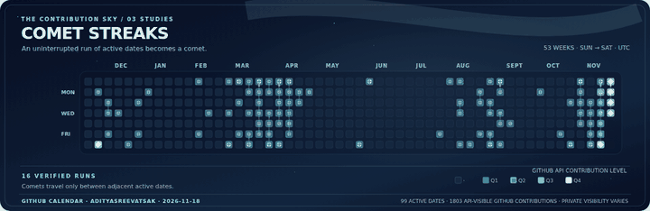
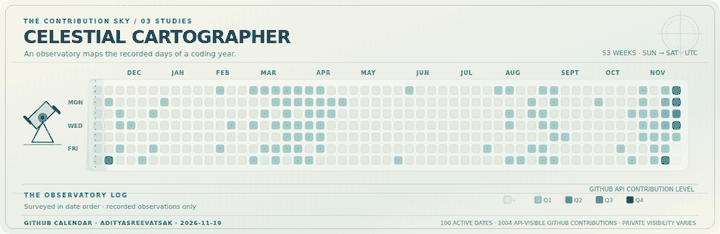
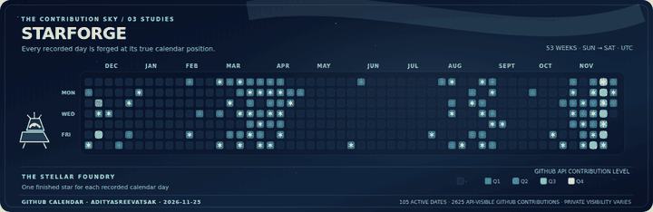

# GitHub Constellation

**A year of coding activity, written in stars.** Three distinct animated reinterpretations of the familiar GitHub contribution calendar, with a 53-week by seven-day lattice and source-backed star positions.

**Status:** Working animation engine and visual prototypes migrated from [GitHub-Activity-Studio](https://github.com/AdityaSreevatsaK/GitHub-Activity-Studio/pull/1) at source commit [be7f524](https://github.com/AdityaSreevatsaK/GitHub-Activity-Studio/commit/be7f524597285c2078565068ab23a683316404a2). **The master branch now includes real GitHub API-visible contribution-calendar previews for @AdityaSreevatsaK**, first collected on 18 November 2026 and refreshed automatically. See the verified snapshot timestamp below. The original synthetic demonstrations are kept clearly separate. The reusable Action and owner-only daily preview refresh are available on master. Live profile installation remains optional and has not been performed.

## Your actual GitHub Constellation

**Verified source:** GitHub GraphQL contribution calendar for [@AdityaSreevatsaK](https://github.com/AdityaSreevatsaK). The complete 53-week display is refreshed automatically; private contribution visibility depends on GitHub settings and API-token scope.

<!-- CONSTELLATION_SUMMARY_START -->
**Snapshot verified:** 2026-11-21 09:58 UTC. **2,473 API-visible GitHub contributions** across **102 active dates** and **16 consecutive active-day runs**.
<!-- CONSTELLATION_SUMMARY_END -->

**Three original animations, both themes**, with motionless SVG alternatives.

### Real Comet Streaks

[Paper GIF](assets/real/AdityaSreevatsaK/comet-paper.gif) · [Night still](assets/real/AdityaSreevatsaK/comet-night-still.svg) · [Paper still](assets/real/AdityaSreevatsaK/comet-paper-still.svg)

### Real Celestial Cartographer

[Night GIF](assets/real/AdityaSreevatsaK/cartographer-night.gif) · [Night still](assets/real/AdityaSreevatsaK/cartographer-night-still.svg) · [Paper still](assets/real/AdityaSreevatsaK/cartographer-paper-still.svg)

### Real Starforge

[Paper GIF](assets/real/AdityaSreevatsaK/starforge-paper.gif) · [Night still](assets/real/AdityaSreevatsaK/starforge-night-still.svg) · [Paper still](assets/real/AdityaSreevatsaK/starforge-paper-still.svg)

The first complete real-data pipeline is verified in [GitHub Actions](https://github.com/AdityaSreevatsaK/GitHub-Constellation/actions/workflows/owner-calendar.yml). All six real GIFs were tested for a complete 16-second loop and all twelve SVG assets were checked for the official source marker. GitHub's actual image-proxy playback should still be checked manually on this README.

This is not a screenshot or estimate of GitHub's proprietary profile chart. It uses the authorised GitHub GraphQL calendar, whose visibility and freshness depend on API scope. It never converts example repository events into fictitious contributions.

---

## Three animation designs

| Concept | Night | Paper |
|:--|:--|:--|
| **Comet Streaks**: a comet follows consecutive active calendar dates, with breaks wherever activity is absent |  |  |
| **Celestial Cartographer**: a miniature observatory reveals activity chronologically |  |  |
| **Starforge**: sparks travel from a forge to exact recorded dates, leaving permanent day-stars |  |  |

Each design has six source-controlled SVG representations across the two sample datasets, two themes and animated/still variants. The six native 16-second GIFs have been regenerated and committed by [the preview-generation workflow](.github/workflows/generate-gifs.yml) using Pillow and headless Chromium. The committed SVG stills above remain reliable reduced-motion alternatives. Actual playback through GitHub's image proxy still needs independent visual confirmation.

## Animated showcase

The following animations show the explicitly labelled **SYNTHETIC STREAK STRESS TEST** fixture, not the owner's contribution history. Each GIF plays for 16 seconds and has a motionless SVG alternative.

### Comet Streaks

[Paper GIF](assets/stress/comet-paper.gif) · [Night still](assets/stress/comet-night-still.svg) · [Paper still](assets/stress/comet-paper-still.svg)

### Celestial Cartographer

[Night GIF](assets/stress/cartographer-night.gif) · [Night still](assets/stress/cartographer-night-still.svg) · [Paper still](assets/stress/cartographer-paper-still.svg)

### Starforge

[Paper GIF](assets/stress/starforge-paper.gif) · [Night still](assets/stress/starforge-night-still.svg) · [Paper still](assets/stress/starforge-paper-still.svg)

All six GIFs are included in this repository: three distinct animation concepts, two themes each. Brightness means **mixed recorded activity units in the demo**, not official GitHub contribution counts. Empty cells mean that the sample contains no event, not that GitHub has certified zero contributions.

## Try it locally on Windows

Requires Node.js 20+ and Python 3.11+; the SVG renderer has **no npm dependencies**.

~~~powershell
git clone https://github.com/AdityaSreevatsaK/GitHub-Constellation.git
cd GitHub-Constellation

# Run all Node tests, including official data, Action validation and README statistics
node --test tests/test_engine.mjs tests/test_motion.mjs tests/test_official.mjs tests/test_action.mjs tests/test_readme.mjs

# Regenerate all still and animated SVGs from the ten-event synthetic fixture
node export.mjs

# Regenerate the richer 65-active-day demonstration
node export.mjs --input fixtures/streak-demo.json --out assets/stress --label "SYNTHETIC STREAK STRESS TEST"

# Serve a local interactive gallery
py -3 -m http.server 8000
~~~

Open **http://localhost:8000/preview.html**. The gallery supports all three designs, both themes, two synthetic fixtures, side-by-side comparison, pause and keyboard-readable day inspection. It does not fetch the owner's official data. On mobile, calendars scroll horizontally within their panels.

Optional animated GIF generation:

~~~powershell
py -3 -m pip install pillow playwright
py -3 -m playwright install chromium
py -3 export_gif.py
py -3 -m unittest tests/test_gif.py -v
py -3 tests/browser_smoke.py
~~~

GIFs are 720 by 234 pixels, play for 16 seconds and must pass frame-duration and visible-motion tests.

## Collect and render an official GitHub calendar

The read-only collector queries the official GitHub GraphQL contribution calendar and writes a separate v2 snapshot. It requires GH_TOKEN or GITHUB_TOKEN in the environment; never commit the snapshot.

~~~powershell
$env:GH_TOKEN = "YOUR_TOKEN"
node collect-contributions.mjs --username YOUR_GITHUB_USERNAME --out local-output/official.json
node export.mjs --input local-output/official.json --out local-output/images --design all --theme both
py -3 export_gif.py --source local-output/images --out local-output/images
Remove-Item Env:GH_TOKEN
~~~

The collector supports --as-of YYYY-MM-DD, defaulting to the current UTC date. It validates the complete 53-week calendar window and fails closed on API errors. The output is labelled API-visible; private contribution visibility depends on GitHub settings and token authorisation. See [data contracts](docs/DATA_CONTRACT.md), [source and privacy rules](docs/DATA_SOURCES.md) and [Action installation](docs/PROFILE_INSTALLATION.md).

## Architecture at a glance

- **engine.mjs**: shared 371-cell model, strict event-sample and official-calendar parsers, streaks and three SVG renderers.
- **official_calendar.mjs / collect-contributions.mjs**: authenticated, read-only GitHub GraphQL collector and validated local snapshot CLI.
- **export.mjs / export_gif.py**: deterministic SVG export and optional Chromium/Pillow native GIF encoding.
- **preview.html**: interactive gallery for the two synthetic fixtures only; it does not load live account data.
- **action.yml / validate-action.mjs**: reusable composite Action with validated inputs and safe workspace output.
- **update_readme_stats.mjs**: keeps the marked README summary aligned with official assets.
- **fixtures/**: ten-event and stress-test **synthetic** snapshots.
- **tests/**: five Node test files, Python GIF tests and offline Chromium browser smoke.
- **assets/**: synthetic SVG/GIF exports and API-visible owner previews under assets/real/AdityaSreevatsaK/.
- **.github/workflows/**: quality gates, synthetic GIF generation and owner-only daily refresh.
- **docs/**: architecture, both data contracts, source provenance, development, testing, migration and current roadmap.

Start with [AGENTS.md](AGENTS.md) when using AI coding agents, then [architecture](docs/ARCHITECTURE.md), [data integrity](docs/DATA_SOURCES.md), [development](docs/DEVELOPMENT.md), [quality gates](docs/TESTING.md) and [next implementation tasks](docs/ROADMAP.md).

## Important limitations and public-release plan

**Reusable profile Action available on master, not installed into anyone's profile.** The read-only official GraphQL collector is separate from the older synthetic event contract. The [reusable Action](action.yml), [profile installation instructions](docs/PROFILE_INSTALLATION.md) and [owner-only automated refresh](.github/workflows/owner-calendar.yml) are included in master. Daily owner-preview refresh is enabled on this repository's default branch. No other repository or live profile is modified.

Next milestones: GitHub-hosted animation playback review, external consumer acceptance, collector resilience and release readiness. See [ROADMAP](docs/ROADMAP.md).

The migration excludes unrelated Studio concepts and obsolete radial/clustered/calendar prototype art. The original [draft PR #1](https://github.com/AdityaSreevatsaK/GitHub-Activity-Studio/pull/1) is retained as migration provenance.

**Licence:** Not yet selected by the owner. Do not assume permission to reuse publicly until a licence is published.
